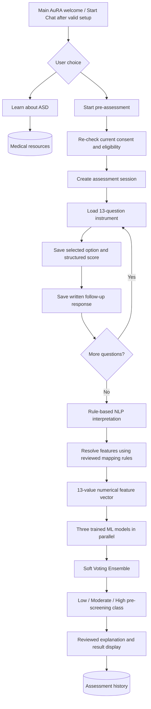
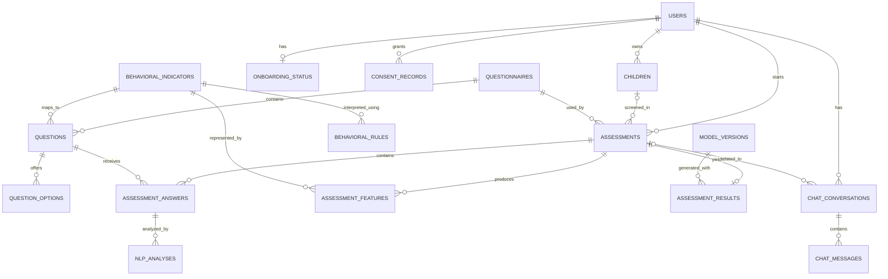

# AuRA — Database Development Plan

**Repository layout update (2026-10-23):** The application now lives in `frontend/`. Source, public assets, tests, package/config files and build paths in this document are relative to that directory unless explicitly prefixed. Run frontend npm and browser-test commands from `frontend/`. Shared `docs/` and `documentation/` remain at the repository root. See [frontend guide](../frontend/README.md).

**Project:** AuRA (Autism Risk Analytics)  
**Document type:** Database blueprint and phased implementation plan  
**Recommended database:** PostgreSQL  
**Status:** Authentication tables implemented; remaining database design is proposed.

**Planning update (2026-10-23):** Frontend authentication/onboarding still use mock state. A separate FastAPI email/password API now persists users and HttpOnly cookie sessions in PostgreSQL. Server-owned onboarding, durable consent and screening data remain unimplemented. Other database schemas remain proposals. See the [current development roadmap](../docs/roadmap.md) and [backend setup](../backend/README.md).

**Backend implementation update (2026-10-23):** FastAPI email/password authentication and PostgreSQL-backed HttpOnly sessions are implemented in `backend/`. Alembic revision `20261023_01` creates `users` and `auth_sessions` in the separate local `aura_db`. This updates the earlier frontend-only baseline above. Other proposed schema tables, frontend auth integration, server onboarding/consent/eligibility, screening persistence and NLP/ML remain pending. See the [current roadmap](../docs/roadmap.md) and [backend guide](../backend/README.md).

## 1. Purpose and sources

This document describes a proposed database design for the AuRA web application. It is intended to support development in this order:

1. **Frontend UI:** React + TypeScript + Vite, initially using mock data.
2. **Backend server:** FastAPI (selected), with implemented auth contracts and further screening contracts pending.
3. **Database server:** PostgreSQL and database migrations.
4. **NLP and machine learning:** Rule-based text interpretation, behavioral feature mapping, Logistic Regression, Random Forest, XGBoost, and Soft Voting Ensemble.

**Basis:**
- *AuRA chatbot UI screens.pdf* — five reference screens showing welcome/chat, conversational choices, ASD explanation, Question 1/13 with multiple-choice answers, and its open-ended follow-up.
- *THESIS-2_CHAPTER-1-3_2026-10.pdf* — Chapters 1–3 describing the 12–36-month toddler target, 13-item screening instrument, informed consent, scoring, rule-based NLP, numerical feature vectors, three ML models and educational chatbot.

**Source vs. recommendation:** The UI and thesis define expected behaviors, but **do not prescribe the database table names, login design, persistence strategy, model storage format, or exact structured-answer/NLP reconciliation rules**. All schemas, fields, APIs, and statuses below are engineering recommendations, not claims that the thesis already defines them.

> **Medical limitation:** AuRA is an ASD **pre-screening and educational support** system. Results are not an autism diagnosis and should not be presented as medical certainty.

---

## 2. Application-to-database workflow



**Key rule:** A single assessment contains the **13 question/answer pairs**. Do **not** create a new assessment for every question. Preserve original answers even after interpretation.

**Revised entry boundary:** Authentication and any required onboarding happen before this main-chat workflow, as specified in Section 2.1. The consent/eligibility re-check above is an access validation, not consent or profile screens embedded in chat. If requirements are missing or expired, return to the required standalone step. After setup, return to the standard welcome/Start Chat experience; do not automatically launch Question 1.

### 2.1 Authentication and Standalone Onboarding Experience

**Latest approved entry revision:** The frontend implementation prompt supersedes the former splash-first entry: signed-out visitors see Login / Register immediately, with no pre-login overlay or artificial timer. Only users requiring onboarding see a short animated AuRA transition after successful sign-in. The retired initial splash is retained below only as decision history.

**User-approved requirements:** Parent/guardian authentication and onboarding are separate from the existing chatbot interface. Login and required onboarding use standalone full-screen experiences. The sidebar, chat input, message bubbles, and assessment conversation belong only to the main application; the earlier pre-login splash [1] is retired by the latest entry revision.

**Decision history:** The earlier workflow began at Welcome/Chat and collected consent/child information after Start pre-assessment. This is superseded by the separate pre-chat sequence below. The five-page PDF remains the visual reference for the main chatbot after setup. Account-based access is now selected for this journey; the previous account-versus-guest alternative is no longer an unresolved requirement. Guest screening, admin login, healthcare-professional login, and additional roles are not approved requirements and remain undecided.

#### User-approved end-to-end journey

```text
UNAUTHENTICATED VISITOR OPENS SITE
    |
    v
[LOGIN / REGISTER LANDING]  <-- FIRST SCREEN, ALWAYS for signed-out visitors
    | (mock successful sign-in)
    v
[CHECK MOCK ONBOARDING STATUS]
    |
    +-- New / incomplete onboarding -------------------+
    |                                                   |
    |                                                   v
    |                                     [ANIMATED AuRA SPLASH]
    |                                                   |
    |                                                   v
    |                                     [ABOUT PRE-ASSESSMENT]
    |                                                   |
    |                                                   v
    |                                     [PRIVACY & INFORMED CONSENT]
    |                                                   |
    |                                                   v
    |                                     [PARENT & CHILD INFORMATION]
    |                                                   |
    |                                                   v
    |                                     [YOU'RE ALL SET]
    |                                                   |
    +---------------------------------------------------+
    |
    +-- Returning mock user with completed valid setup ------+
                                                             |
                                                             v
                                            [EXISTING MAIN AuRA CHAT UI]
```

The diagram shows the latest login-first sequence. Check an existing authenticated session without a pre-login splash: completed/valid users enter main chat, while incomplete users see the post-login transition and resume the required step. The in-memory frontend demo resets safely to Login on refresh; durable session restoration belongs to future integration.

#### Screen responsibilities and mandatory checks

| Screen | Planned behavior |
|---|---|
| [1] Retired pre-login splash | Historical requirement only. Superseded by immediate Login / Register for signed-out visitors; do not implement a pre-login splash or timer. |
| [2] Login / Registration | Standalone parent/guardian sign-in and account creation outside `AppLayout`. Authentication success does not bypass required setup. Provider, credential implementation, and session mechanism remain open technical decisions. |
| [3] Authentication + onboarding status check | Check the authenticated identity, completion of current onboarding requirements, eligibility information, and applicable valid consent. Send completed/valid users to main chat; send new/incomplete users to separate onboarding. Changed consent language or critical terms may require explicit re-consent. |
| [4] Post-login splash / branded transition | A short full-screen animated AuRA transition after successful login/status checking and before required onboarding. This is now the only splash occurrence and is skipped by completed/valid returning users. |
| [5] About Pre-assessment | Explain AuRA in parent-friendly language: toddlers **12–36 months**, **13 structured screening questions with open-ended follow-ups**, and written descriptions supporting rule-based NLP behavioral interpretation followed by ML-assisted **Low / Moderate / High pre-screening categorization** once real ML is integrated. Prominently state: **AuRA is not a diagnosis, does not determine whether a child has autism, and does not replace evaluation by a licensed professional.** Provide Back/Continue and clear step progress. |
| [6] Privacy & Informed Consent | A readable, separate step before collecting or processing parent/child screening information. Require explicit affirmative agreement with no pre-checked consent. Explain actual purposes, data categories, processing, relevant access, retention, deletion/contact mechanism, and voluntary participation once finalized. Declining blocks screening setup and assessment access; offer Back/Exit. Production consent records require version, scope, acceptance, and timestamp. |
| [7] Parent & Child Information | Collect minimum necessary information: parent/legal-guardian role or relationship, confirmation of regular direct interaction with the child, and child age in months with **12–36 months** eligibility validation. Other fields require justification. Offer correction/Back for invalid age or ineligible role. Do not require a child's full name, address, medical records, or diagnosis without a documented reason. A DOB field requires separate justification. |
| [8] You're All Set! | Full-screen confirmation with **Continue to AuRA / Enter AuRA**. Mark setup complete only after mandatory eligibility and consent checks succeed, not because this page was visited. This is not a screening result. |
| [9] Main AuRA chat interface | Enter the existing PDF-based welcome/Start Chat experience. Let the user choose Learn About ASD or Pre-assessment. Do not automatically start Question 1. The 13-item assessment remains within the main chatbot's assessment flow, separate from onboarding. |

**Consent and profile safeguards:** Required screening-use consent and optional research/model-training consent must be separate choices and scopes. App-use consent does not authorize retraining on live parent data. Consent wording and actual access, retention, withdrawal, deletion, and contact processes need thesis/clinical/privacy stakeholder approval before production; do not promise “100% secure” or “completely anonymous.” Public educational content may remain available without screening data where supported, but this does not authorize guest screening or settle the public-access design.

Keep account profile, child profile, and per-assessment information conceptually separate. Snapshot age at each assessment; later profile corrections must not silently rewrite historical age, original responses, consent evidence, or results. Re-check age eligibility and applicable consent when a new assessment is requested, rather than treating onboarding completion as permanent eligibility.

#### Routing, state, and edge cases

| Scenario | Expected destination / handling |
|---|---|
| Unauthenticated visitor | Login/Register immediately; no pre-login splash. |
| Already authenticated application entry | Status check without a pre-login splash → main chat if valid, otherwise post-login transition and required standalone onboarding. |
| First login / setup not started | Login → post-login animated splash → About → Consent → Parent & Child → All Set → main welcome/Start Chat. |
| User exits midway through onboarding | After the next login/status check, use the short onboarding transition and resume the required incomplete step, subject to current consent and valid prior entries. Durable cross-login/reload resumption belongs to the future backend/database phases. |
| Returning user with completed valid onboarding | Skip the post-login splash and completed onboarding; enter main chat. |
| User declines required consent | Block assessment onboarding and assessment access; offer Back/Exit. Education-only access may remain available if it requires no screening data and is supported by the product policy. |
| Missing/invalid eligibility information | Show a clear correction state; allow Back; do not mark setup complete or create a screening attempt. |
| Consent needs renewal | Route to the updated standalone consent step before assessment access; preserve valid prior entries where appropriate and do not repeat unnecessary setup. |
| User logs out | End the authenticated session. Future protected access requires login; clear user-specific frontend state so another account cannot see prior responses. |
| User revisits profile/settings | Allow relevant corrections later without silently rewriting past assessment records; validate eligibility again for subsequent assessments. |

**Frontend implementation status:** The following behavior is implemented using temporary mock state; server-side enforcement remains pending. Use a deterministic onboarding state model with validated transitions, a clear step indicator, and Back/Continue controls. Route guards must check authentication and current setup/consent requirements, including direct navigation to protected routes. Page visits alone cannot complete setup. Frontend guards guide the UI; the future backend must independently validate authorization, consent scope/version, eligibility, and completion.

#### Frontend architecture and visual direction

The frontend uses `src/app/AppRouter.tsx`, `src/app/providers/`, `src/components/layout/`, `src/pages/`, `src/contexts/`, `src/hooks/`, `src/types/`, and service adapters. The tree below retains the original logical proposal; actual file names and ownership are documented in [frontend guide](../frontend/README.md). No source files are created by this documentation update.

```text
src/
  app/
    AppRouter.tsx                 # Planned auth/onboarding/main route groups and guards
    providers/                    # Planned shared auth and onboarding state
  components/
    layout/
      AuthLayout                  # Standalone login/registration shell
      OnboardingLayout            # Standalone full-screen setup shell
      AppLayout                   # Existing main chat/sidebar shell
    onboarding/                   # Planned step progress, navigation, consent controls
    branding/                     # Reuse existing AuRA logo and mascot
  pages/
    LoginPage
    RegisterPage                  # If registration uses a separate screen
    onboarding/
      OnboardingSplashPage
      AboutAssessmentPage
      ConsentPage
      ParentChildInfoPage
      OnboardingCompletePage
    WelcomePage                   # Existing main welcome / Start Chat
    ChatPage                      # Existing conversation
    AssessmentPage                # Existing assessment flow
  contexts/                       # Planned typed auth/onboarding context access
  hooks/                          # Planned auth/onboarding behavior following current conventions
  types/
    auth.types.ts
    onboarding.types.ts
    consent.types.ts
  services/
    mock/                         # Planned frontend-only simulation
    api/                          # Planned future backend contracts/adapters
```

The implementation keeps three separate route/layout groups: mock authentication; standalone onboarding; and the main application after valid mock setup. Route URLs and frontend guards are defined in `src/constants/routes.ts`, `src/app/AppRouter.tsx` and `src/app/DemoRouteGate.tsx`; real server authorization remains pending. Shared branding uses the supplied robot artwork/animation, palette, typography and design tokens. Onboarding remains separate from the main chat shell. Later user-approved refinements add animated mascot speech bubbles to standalone screens. Preserve responsive layouts, keyboard navigation, visible focus and reduced-motion support.

**Frontend-first boundary:** The frontend now simulates identity, onboarding status, consent, and eligible profiles with typed temporary in-memory state and dedicated mock services. Do not claim real authentication, durable consent, or production persistence. Reloading may reset the demo; do not persist real children's sensitive information in localStorage by default. Secure sessions and validation belong to Phase 2; durable records and resumption belong to Phase 3; real NLP/ML follows in Phase 4. Backend/database capability planning is in Section 8.1.

### UI reference mapping

| UI reference | Feature | Primary database objects |
|---|---|---|
| Page 1: Welcome / Chat | Main entry after valid setup and chat | `chat_conversations`, `chat_messages` |
| Page 2: Chat choices | ASD information or pre-assessment | `chat_conversations`, `medical_resources`, `assessments` |
| Page 3: ASD explanation | Curated educational response | `medical_resources`, `chat_messages` |
| Page 4: Question 1/13 | Main question, options, selected answer, progress | `questionnaires`, `questions`, `question_options`, `assessments`, `assessment_answers` |
| Page 5: Follow-up | Parent-written answer and next question | `assessment_answers`, `assessments`; later `nlp_analyses` |
| History / Results navigation | Past assessments and results | `assessments`, `assessment_results` |
| Settings / Support navigation | UI concepts requiring product decisions | No dedicated tables unless features are defined |

**UI quality note:** In the illustrated Question 1 screen, the tag *Eye Contact* appears beside a question about responding to a child's name. Resolve this indicator-label mismatch against the final reviewed questionnaire before seeding the database.

---

## 3. Proposed database tables

The tables below are a **logical plan**. Create them in phases; not every table must exist on day one.

### A. Core assessment tables

| Table | Responsibility | Priority |
|---|---|---|
| `users` | Parent/guardian identity for the approved account-based journey; authentication architecture remains open | Planned core identity |
| `onboarding_status` | Logical per-user completion and last validated step; may be represented differently in the final schema | Planned setup state |
| `children` | Minimal eligible child profile linked to the responsible parent/guardian; exact physical design remains open | Planned profile data |
| `consent_records` | Consent text version, explicit acceptance, scope and date/time, including onboarding before an assessment exists | Essential |
| `questionnaires` | Versioned screening instrument | Essential |
| `behavioral_indicators` | Reviewed indicator definitions | Essential |
| `questions` | Main questions and open-ended follow-up prompts | Essential |
| `question_options` | Available structured choices and their exact scores | Essential |
| `assessments` | One complete attempt from initialization to result | Essential |
| `assessment_answers` | Original option and follow-up text per question | Essential |

### B. NLP and ML integration tables

| Table | Responsibility | Priority |
|---|---|---|
| `behavioral_rules` | Versioned rule-based lexicon / interpretation definitions | Later |
| `nlp_analyses` | Per-answer extracted meaning, status, and rule version | Later |
| `assessment_features` | Final per-indicator ordinal features used for prediction | Later |
| `model_versions` | Version, model artifacts, feature schema, and provenance | Later |
| `assessment_results` | Ensemble classification and associated model outputs | Later |

### C. Chat and educational content tables

| Table | Responsibility | Priority |
|---|---|---|
| `chat_conversations` | Separate chat sessions, including educational conversations | For Chat |
| `chat_messages` | User and chatbot messages | For Chat |
| `medical_resources` | Reviewed ASD educational text and citations | For Resources |

### Optional additional table

`ground_truth_labels` — only if the research workflow requires storing independently expert-reviewed labels and provenance in the operational DB. **Prefer keeping the restricted research/training dataset separate from production parent screening records.**

---

## 4. Recommended schema (conceptual fields)

**Convention:** Use PostgreSQL `uuid` for identifiers; use `timestamptz` for timestamps; use foreign keys for relationships; store enum-like values with check constraints or reference tables. The examples are *not* migration-ready SQL.

### 4.1 `users` (account identity proposal)

| Column | Type | Notes |
|---|---|---|
| `id` | uuid PK | User ID |
| `email` | text UNIQUE | If email accounts are supported |
| `password_hash` | text | Only if local credentials are selected; never plaintext passwords; provider design remains open |
| `display_name` | text | Optional, minimum necessary |
| `created_at` | timestamptz | Account creation |
| `updated_at` | timestamptz | Last update |

**Revised decision:** The PDF itself does not show sign-in/sign-up, but the subsequently approved journey requires parent/guardian accounts before main-app access (Section 2.1). Account versus guest access was previously an open proposal; guest screening is not part of the approved journey. The authentication provider, credentials, session mechanism, and physical identity fields remain future technical decisions. An assessment UUID alone must never grant access.

**Onboarding state proposal:** Plan an appropriate per-user representation of requirements/completion status and the last validated step, conceptually `onboarding_status`. Recompute access from current consent and eligibility as necessary; a completion flag alone is insufficient. Exact fields, storage placement, and transaction rules are not settled here; see Section 8.1.

### 4.2 `children` (minimal profile proposal)

| Column | Type | Notes |
|---|---|---|
| `id` | uuid PK | Child profile |
| `user_id` | uuid FK → users.id | Associated parent account |
| `nickname` | text nullable | Avoid unnecessary identifiers |
| `birth_month_year` | date nullable | Only if truly needed; prefer minimal data |
| `created_at` | timestamptz | Creation |

**Important:** Regardless of profile design, store the child's **age in months at the specific assessment** as a snapshot in `assessments`.

The approved information requirements are role/relationship, regular direct interaction, and age eligibility (Section 2.1). Their exact representation across parent/guardian relationship data, child profiles, and assessment snapshots remains a future schema decision. Longitudinal history does not justify requiring additional sensitive identifiers.

### 4.3 `consent_records`

| Column | Type | Notes |
|---|---|---|
| `id` | uuid PK | Consent record |
| `assessment_id` | uuid FK → assessments.id, nullable proposal | Optional linkage; onboarding consent may exist before an assessment is created |
| `consent_version` | text | Exact wording/version shown |
| `accepted` | boolean | Must be true before sensitive processing |
| `accepted_at` | timestamptz nullable | Timestamp |
| `withdrawn_at` | timestamptz nullable | Withdrawal if supported |

Consent should be validated in the backend, not only by a frontend checkbox. Agree on handling of withdrawal, retention and deletion before implementation.

**Revised lifecycle:** The earlier assessment-only linkage is insufficient for consent collected during standalone onboarding. Plan records associated with the authenticated identity and relevant scope/version before any screening/profile collection, then verify the applicable consent for each assessment. Exact ownership/linkage fields, cardinality, and whether an assessment-specific acceptance is additionally required remain unresolved. Keep necessary screening consent separate from optional research/training consent and retain evidence of re-consent rather than overwriting prior acceptance.

### 4.4 `questionnaires`

| Column | Type | Notes |
|---|---|---|
| `id` | uuid PK | Questionnaire version ID |
| `name` | text | Researcher-developed AuRA questionnaire |
| `version` | text | e.g. `1.0` |
| `status` | text | `draft`, `approved`, `retired` |
| `approved_at` | timestamptz nullable | If reviewed |

Never silently change question wording/scoring for an existing version tied to saved assessments. Publish a **new questionnaire version**.

### 4.5 `behavioral_indicators`

| Column | Type | Notes |
|---|---|---|
| `id` | uuid PK | Behavioral indicator |
| `code` | text UNIQUE | e.g. `IND_01` |
| `title` | text | Reviewed indicator name |
| `definition` | text | Reviewed interpretation |
| `source_notes` | text nullable | Instrument/expert rationale |

The thesis specifies **13 indicators**, informed by M-CHAT-R/F, Q-CHAT, CSBS-DP ITC and expert review. **Do not invent the official names or interpretations**: use the final approved instrument.

### 4.6 `questions`

| Column | Type | Notes |
|---|---|---|
| `id` | uuid PK | Question ID |
| `questionnaire_id` | uuid FK | Version of questionnaire |
| `indicator_id` | uuid FK | Target indicator |
| `position` | smallint | 1–13 |
| `text_en` | text | Main question in English |
| `text_fil` | text nullable | Filipino version |
| `followup_en` | text | Open-ended follow-up |
| `followup_fil` | text nullable | Filipino follow-up |
| `is_active` | boolean | Optional lifecycle field |

**Constraint:** Unique (`questionnaire_id`, `position`). The 13 questions are a **version-specific requirement**; validate exact count when publishing the instrument, rather than a global constraint on all drafts.

### 4.7 `question_options`

| Column | Type | Notes |
|---|---|---|
| `id` | uuid PK | Option ID |
| `question_id` | uuid FK | Parent question |
| `code` | text | `always`, `sometimes`, `never`, `yes`, `no` |
| `label_en` | text | Display label |
| `label_fil` | text nullable | Localized label |
| `score` | smallint | Validated value 0, 1 or 2 |
| `display_order` | smallint | Button order |

**Scoring stated in Chapter 3:**

| Question group | Selected answer | Score |
|---|---|---:|
| Q1–Q9 | Always | 0 |
| Q1–Q9 | Sometimes | 1 |
| Q1–Q9 | Never | 2 |
| Q10–Q13 | Yes | 2 |
| Q10–Q13 | Sometimes | 1 |
| Q10–Q13 | No | 0 |

Keep **scores in the database**, not duplicated and hardcoded independently throughout the UI. The API should supply them when needed; the backend remains the authority for submitted scores.

### 4.8 `assessments`

| Column | Type | Notes |
|---|---|---|
| `id` | uuid PK | One screening attempt |
| `user_id` | uuid FK → users.id | Responsible authenticated parent/guardian for the approved screening journey |
| `child_id` | uuid FK nullable | Optional child profile |
| `questionnaire_id` | uuid FK | Exact instrument used |
| `age_months` | smallint | Must be 12–36 at assessment time |
| `status` | text | `in_progress`, `completed`, `cancelled` |
| `current_question` | smallint | UI position, 1–13 |
| `started_at` | timestamptz | Start time |
| `completed_at` | timestamptz nullable | Finished |
| `created_at` | timestamptz | Creation |
| `updated_at` | timestamptz | Last save |

Use backend-controlled state transitions. A completed assessment must have all required valid responses and be linked to the correct consent record.

### 4.9 `assessment_answers`

| Column | Type | Notes |
|---|---|---|
| `id` | uuid PK | Answer ID |
| `assessment_id` | uuid FK | Owning assessment |
| `question_id` | uuid FK | Answered question |
| `option_id` | uuid FK | Selected structured option |
| `structured_score` | smallint | Score snapshot (0–2) |
| `followup_text` | text | Original parent text; preserve exactly |
| `answered_at` | timestamptz nullable | Submission timestamp |
| `updated_at` | timestamptz | Editing |

**Constraint:** Unique (`assessment_id`, `question_id`). Validate that the option belongs to that question and that the question belongs to the assessment's questionnaire. Do not delete/overwrite original answers to make them appear consistent with NLP.

### 4.10 `behavioral_rules` (NLP knowledge)

| Column | Type | Notes |
|---|---|---|
| `id` | uuid PK | Rule ID |
| `indicator_id` | uuid FK | Target behavior |
| `ruleset_version` | text | Version |
| `language` | text | English / Filipino / Taglish handling |
| `rule_type` | text | Pattern, negation, frequency, context, etc. |
| `pattern_definition` | jsonb | Structured pattern, not executable user code |
| `mapping_definition` | jsonb nullable | Reviewed effect on interpretation |
| `is_active` | boolean | Rule lifecycle |

Keep rule definitions versioned and editable only by authorized maintainers. Some NLP rules may be more appropriate as code/configuration files; the database is an **option**, not a thesis requirement.

### 4.11 `nlp_analyses`

| Column | Type | Notes |
|---|---|---|
| `id` | uuid PK | Analysis ID |
| `assessment_answer_id` | uuid FK | Source answer |
| `indicator_id` | uuid FK | Interpreted indicator |
| `detected_frequency` | text nullable | e.g. `sometimes` |
| `detected_negation` | boolean nullable | Negation detected? |
| `interpretation` | text nullable | e.g. inconsistent response |
| `consistency_status` | text | `consistent`, `conflict`, `uncertain`, `not_evaluated` |
| `ruleset_version` | text | Used NLP rule version |
| `processed_at` | timestamptz | Processing timestamp |

**Do not** assume that keyword matches guarantee meaning. If a sentence cannot be interpreted reliably, record `uncertain` and apply the approved policy. A clarification question for conflicting answers is a **recommended refinement**, not a confirmed thesis requirement.

### 4.12 `assessment_features`

| Column | Type | Notes |
|---|---|---|
| `id` | uuid PK | Feature row |
| `assessment_id` | uuid FK | Assessment |
| `indicator_id` | uuid FK | One of 13 indicators |
| `final_score` | smallint nullable | 0, 1, 2 when resolved |
| `mapping_status` | text | `resolved`, `needs_review`, `missing` |
| `mapping_version` | text | Reviewed reconciliation policy version |
| `created_at` | timestamptz | Feature generation |

**Constraint:** Unique (`assessment_id`, `indicator_id`). Do not run prediction if essential features remain unresolved. The thesis **does not fully specify** how conflicting multiple-choice and free-text interpretations become a final feature: define this with expert review before coding the final scorer.

### 4.13 `model_versions`

| Column | Type | Notes |
|---|---|---|
| `id` | uuid PK | Version ID |
| `version` | text | e.g. `ensemble-1.0` |
| `algorithm` | text | `soft_voting_ensemble` |
| `artifact_reference` | text | Trusted model artifact path or registry ref |
| `feature_schema_version` | text | Required feature order/transform |
| `training_reference` | text nullable | Training run / dataset version |
| `evaluation_summary` | jsonb nullable | Accuracy, precision, recall, F1, etc. |
| `released_at` | timestamptz nullable | Deployed version |

Avoid placing serialized model binaries directly in ordinary database rows; use trusted artifact storage and store metadata/reference in PostgreSQL.

### 4.14 `assessment_results`

| Column | Type | Notes |
|---|---|---|
| `id` | uuid PK | Result ID |
| `assessment_id` | uuid UNIQUE FK | One current final result per assessment |
| `model_version_id` | uuid FK | Model that predicted |
| `risk_level` | text | `low`, `moderate`, `high` |
| `low_probability` | numeric | Predicted class probability |
| `moderate_probability` | numeric | Predicted class probability |
| `high_probability` | numeric | Predicted class probability |
| `model_predictions` | jsonb nullable | Individual model outputs, if needed |
| `response_template_version` | text nullable | Reviewed message version |
| `generated_at` | timestamptz | Prediction timestamp |

**Probabilities are classifier outputs, not clinically validated diagnostic probabilities.** Validate nonnegative values and sums (allowing numerical tolerance). If re-prediction history is a requirement, use an append-only `prediction_runs` table instead of silently overwriting a result.

### 4.15 `chat_conversations`

| Column | Type | Notes |
|---|---|---|
| `id` | uuid PK | Conversation ID |
| `user_id` | uuid FK nullable | Optional account |
| `assessment_id` | uuid FK nullable | Related assessment, if any |
| `mode` | text | `educational`, `assessment`, etc. |
| `created_at` | timestamptz | Created |
| `updated_at` | timestamptz | Activity |

### 4.16 `chat_messages`

| Column | Type | Notes |
|---|---|---|
| `id` | uuid PK | Message ID |
| `conversation_id` | uuid FK | Conversation |
| `sender` | text | `user`, `assistant`, `system` |
| `message_type` | text | text, question, choices, guidance, etc. |
| `body` | text | Message text |
| `metadata` | jsonb nullable | Buttons, related question IDs, citation IDs |
| `created_at` | timestamptz | Sent time |

**Avoid making chat history the sole source of assessment truth.** Answers, features and results must reside in their own structured tables.

### 4.17 `medical_resources`

| Column | Type | Notes |
|---|---|---|
| `id` | uuid PK | Resource ID |
| `title` | text | Resource heading |
| `topic` | text | ASD topic |
| `content` | text | Reviewed educational text |
| `source_name` | text | Source |
| `source_url` | text nullable | Citation URL |
| `review_status` | text | `draft`, `approved`, `retired` |
| `reviewed_at` | timestamptz nullable | Review date |
| `updated_at` | timestamptz | Last modification |

**Separate knowledge bases:** The **ASD Domain Knowledge** is for NLP indicator/rule interpretation; the **Medical Library** is for educational chatbot responses. Updates to one should not silently alter the other.

---

## 5. Simplified relationships (ERD)



**Cardinality note:** Account identity is required by the approved screening journey. `ONBOARDING_STATUS` is a logical per-user concept, not a committed table. Exact linkage/cardinality between onboarding consent and later assessments is deliberately omitted until the consent scope/lifecycle is finalized; every assessment still requires applicable valid consent. Treat the diagram as a conceptual view, not a complete set of physical constraints. Earlier optional-account/guest assumptions are superseded by Section 2.1.

---

## 6. One-question example: what gets stored?

**Sample UI:**

- Main question: *How often does your child respond when you call his/her name?*
- Selected option: **Sometimes**
- Open-ended follow-up: **"Sometimes he looks, but not always"**

**A. Save user responses (immediately):**

```json
{
  "assessment_id": "<uuid>",
  "question_id": "<uuid-for-q1>",
  "selected_option": "sometimes",
  "structured_score": 1,
  "followup_text": "Sometimes he looks, but not always"
}
```

**B. Later, NLP interpretation (example only):**

```json
{
  "indicator": "response_to_name",
  "frequency": "sometimes",
  "negation_detected": false,
  "interpretation": "inconsistent_response",
  "consistency_status": "consistent",
  "ruleset_version": "1.0"
}
```

**C. Behavioral mapping:** When the interpretation and structured answer agree and the **reviewed mapping rule** resolves them to `1`, save final score `1` in `assessment_features`.

**Not a formula:** `structured_score 1 + NLP score 1 = 2` is **not** part of the plan. Keep the structured score, text interpretation and final feature distinct.

**D. Complete all 13 questions** → ensure all 13 required features are resolved → create a **Numerical Feature Vector (NFV)** in the expected indicator order → predict with trained ML models → store result.

---

## 7. Example machine-learning result storage

**Illustrative probabilities, not actual AuRA model results:**

| Model | Low | Moderate | High |
|---|---:|---:|---:|
| Logistic Regression | 10% | 65% | 25% |
| Random Forest | 20% | 60% | 20% |
| XGBoost | 15% | 55% | 30% |
| **Soft Voting mean** | **15%** | **60%** | **25%** |

The winning predicted class in this example is **Moderate** because it has the highest mean class probability. The three models process the **same NFV in parallel**, not as a sequential pipeline. Save the model/pipeline versions used to produce this prediction.

---

## 8. Suggested API contract for frontend-first development

These existing assessment/chat endpoint URLs remain **recommended**, not finalized contracts, and can initially return mock data. Parent/guardian account access is now selected; finalize the authentication/session architecture before real integration. Planned authentication/onboarding capabilities are listed separately in Section 8.1 without assigning endpoint URLs.

| Method | Endpoint | Purpose |
|---|---|---|
| `GET` | `/api/v1/questionnaires/active` | Get versioned questions, options and prompts |
| `POST` | `/api/v1/assessments` | Start assessment with validated eligibility/consent flow |
| `GET` | `/api/v1/assessments/{id}` | Fetch owned/authorized session and progress |
| `PUT` | `/api/v1/assessments/{id}/answers/{questionId}` | Upsert answer and follow-up |
| `POST` | `/api/v1/assessments/{id}/complete` | Validate and finalize submission |
| `GET` | `/api/v1/assessments/{id}/result` | Retrieve final result (when available) |
| `GET` | `/api/v1/assessments` | Authorized history, if history feature is enabled |
| `POST` | `/api/v1/conversations` | Open chat session |
| `POST` | `/api/v1/conversations/{id}/messages` | Add message and receive reviewed chatbot reply |
| `GET` | `/api/v1/resources` | Browse approved educational references |

**Security:** All protected session-specific endpoints must verify the authenticated account's ownership and applicable setup/consent requirements. A UUID alone is **not** authorization. Validate responses server-side, including option/question/instrument relationships. The former guest-recovery alternative is not an approved screening feature.

### 8.1 Future authentication and onboarding capabilities

This section describes future responsibilities only; it does not define new endpoint URLs, DB fields, migrations, login libraries, or external auth providers.

| Capability | Planned backend responsibility | Planned persistence responsibility |
|---|---|---|
| Sign in/register and check/end session | Establish, validate, and end parent/guardian sessions using the selected authentication architecture; enforce access independently of frontend guards | Appropriate user/identity association, subject to the chosen auth design |
| Read setup status | Determine completed and missing steps against current requirements, eligibility and valid consent; return the required continuation step | Per-user onboarding completion and last validated step, conceptually `onboarding_status` |
| Submit or renew consent | Record affirmative agreement for the exact version/scope; reject missing/declined required consent; separate screening-use and optional research/training choices | Versioned acceptance evidence, scope and timestamp; retention/withdrawal/deletion policy and record linkage to be finalized |
| Save/retrieve eligible profile details | Validate parent/legal-guardian relationship, regular direct interaction, and **12–36 months** eligibility; minimize collection | Appropriate parent/guardian relationship and linked child profile records, separate from account credentials and individual assessment records |
| Mark required setup complete | Validate all mandatory requirements before acknowledging completion; support safe resume and re-consent rather than trusting a visited page or client boolean | Validated per-user completion/resume state consistent with the applicable consent and profile records |
| Begin a later assessment | Re-check authorization, valid consent and current eligibility; create an attempt only following the user's explicit pre-assessment choice | Assessment-specific age snapshot and immutable historical associations to original answers and relevant consent/version evidence |

Phase 1 now simulates these capabilities in typed in-memory frontend state. Phase 2 supplies server-side sessions, authorization and validation using temporary adapters where needed. Phase 3 adds durable PostgreSQL records, secure resume, integrity checks and approved lifecycle handling. Phase 4 preserves the existing rule-based NLP → reviewed feature mapping → ML workflow. No mock state is production persistence, and operational parent records must not silently become training data.

### Mock data types for React (illustrative)

```ts
type RiskLevel = "low" | "moderate" | "high";
type AssessmentStatus = "in_progress" | "completed" | "cancelled";

type QuestionOption = {
  id: string;
  code: string;
  label: string;
  score: 0 | 1 | 2;
};

type Question = {
  id: string;
  position: number;
  indicatorId: string;
  text: string;
  followup: string;
  options: QuestionOption[];
};

type AssessmentAnswer = {
  questionId: string;
  optionId: string | null;
  followupText: string;
};

type Assessment = {
  id: string;
  questionnaireId: string;
  ageMonths: number;
  status: AssessmentStatus;
  currentQuestion: number;
  answers: AssessmentAnswer[];
};

type AssessmentResult = {
  assessmentId: string;
  riskLevel: RiskLevel;
  probabilityByClass: { low: number; moderate: number; high: number };
  modelVersion: string;
};
```

Do not show fake predictions as genuine assessments: mock UI outcomes must be labeled **demo data** until the evaluated ML pipeline is connected.

---

## 9. Development phases and checklist

**Repository baseline (2026-10-23):** The reference-based frontend, mock login/onboarding, bilingual 13-item assessment, processing preview and in-memory session History are implemented. Real authentication, API, persistence, NLP and ML are not. The [current roadmap](../docs/roadmap.md) owns detailed completion tracking; this section summarizes the original four implementation phases.

### Phase 1 — Frontend UI

- [x] Build the shared layout from the supplied five-screen PDF, using actual AuRA assets.
- [x] Implement navigation: Chat (including ASD information), Assessments, Resources, History, Support and Settings. Resources search/filter, Support FAQs and demo Settings are implemented; real policy/contact and clinical resource review remain pending.
- [x] Create chat bubbles, thinking/typewriter states, start actions, progress, answer buttons and follow-up input.
- [x] Show standalone mock Login/Register immediately for signed-out visitors; no pre-login splash.
- [x] Add the post-login animated transition for users requiring onboarding.
- [x] Build separate About, Consent, Parent/Child Information and All Set screens with validated navigation.
- [x] Use AuthLayout, OnboardingLayout and AppLayout route groups, typed in-memory mock state and frontend access guards.
- [x] Demonstrate incomplete setup, valid consent/eligibility checks, returning fixtures and sign out without browser-storage persistence.
- [x] Enter welcome/Start Chat after valid setup; begin assessment only by choice.
- [x] Implement 13 approved-source questions and follow-ups, explicit English/Tagalog selection and automatic advancement in one continuous transcript.
- [x] Preserve canonical question/option IDs, questionnaire version, structured scores and verbatim explanations.
- [x] Show clearly labeled processing simulation and unavailable-risk-result notice, without fabricated clinical classes.
- [x] Implement multiple in-memory chat/assessment records and resumable History.
- [x] Define typed domain models and separate asynchronous service adapters for future API integration.
- [x] Implement Resources, Support FAQs and frontend Settings using the shared design; no fake contact or account service.
- [x] Review consent/decline and rerun frontend accessibility, responsive and end-to-end browser checks.
- [ ] Obtain approved privacy/terms, contact details and clinical/bilingual resource review; verify physical mobile keyboards.

### Phase 2 — Backend API

- [ ] Confirm backend framework (FastAPI recommended), then set up the selected server.
- [ ] Define Pydantic schemas and API route contracts.
- [ ] Implement consent, eligibility and session state validation.
- [ ] Finalize and implement the selected authentication/session architecture and setup-status, consent-version/scope, eligible-profile and validated-completion capabilities in Section 8.1.
- [ ] Implement get-questionnaire, save-answer, resume-assessment and complete-assessment behaviors.
- [ ] Build a temporary repository/mock persistence adapter until database migration.
- [ ] Enforce authenticated parent/guardian ownership, session termination, setup/consent access rules, and audit logging as appropriate; guest screening is not an approved requirement.

### Phase 3 — PostgreSQL database

- [ ] Install/configure PostgreSQL and create separate development database.
- [ ] Create SQL migrations for core tables and indexes.
- [ ] Seed the **reviewed** 13-question questionnaire and correct scores.
- [ ] Add assessment answers, consent and progress persistence.
- [ ] Persist approved identity links, onboarding/resume status, scoped consent records and minimal parent/child relationships, with assessment-specific age/history preserved (Section 8.1).
- [ ] Wire the selected backend repositories to PostgreSQL.
- [ ] Test restore/resume, ownership, data integrity and migrations.
- [ ] Add chat messages, educational resources and optional history features.

### Phase 4 — NLP and machine learning

- [ ] Finalize indicator-to-question mapping and multilingual lexicon.
- [ ] Define rule-based normalization, negation, frequency and context tests.
- [ ] Finalize expert-reviewed structured-answer/NLP conflict policy.
- [ ] Generate the exact ordered feature vector used in training and inference.
- [ ] Prepare an appropriately consented research training dataset with defensible ground truth labels.
- [ ] Train and evaluate Logistic Regression, Random Forest and XGBoost.
- [ ] Evaluate Soft Voting; test generalization and screening safety (including class-specific recall).
- [ ] Version the models, feature schema, and response templates.
- [ ] Integrate inference into backend and save results.
- [ ] Provide reviewed explanations and consultation guidance; do not claim diagnosis.

---

## 10. Database integrity, performance and privacy

### Important constraints

- Unique (`assessment_id`, `question_id`) for `assessment_answers`.
- Unique (`assessment_id`, `indicator_id`) for `assessment_features`.
- Unique (`questionnaire_id`, `position`) for `questions`.
- `age_months` in `[12,36]` for eligible completed assessments.
- `structured_score` and `final_score` only `0`, `1`, or `2` where present.
- Prediction cannot run with unresolved required features.
- Model output and interpretation must be traceable to questionnaire/rule/feature/model versions.

### Recommended indexes

- `assessments(user_id, started_at DESC)` where account history is supported.
- `assessment_answers(assessment_id, question_id)` UNIQUE.
- `questions(questionnaire_id, position)` UNIQUE.
- `assessment_features(assessment_id, indicator_id)` UNIQUE.
- `chat_messages(conversation_id, created_at)`.

### Sensitive data protection

- Minimize collection of identifiable information about children and guardians.
- Obtain meaningful informed consent for collection and processing.
- Enforce the standalone consent-before-screening-data boundary and separate optional research/training consent described in Section 2.1; do not default to storing sensitive child information in browser localStorage.
- Use TLS/HTTPS, restricted DB roles, encrypted backups as appropriate, and no plaintext secrets.
- Control access to assessment text, individual results, and history; log administrative access when appropriate.
- Define retention periods, withdrawal and deletion behavior before real-world use.
- Keep production parent records distinct from research training/validation datasets.
- Do not automatically use new parent messages as training examples without separate appropriate authorization and safeguards.

---

## 11. Decisions that must be finalized

| Decision | Why it matters | Suggested next step |
|---|---|---|
| Authentication provider, credentials and session architecture | Parent/guardian account access is user-approved, but secure implementation is not selected | Decide before real authentication or account history integration; guest screening and additional roles remain undecided, not required |
| Onboarding state and profile representation | Determines validated completion, resumable steps and separation of account, child and assessment records | Finalize minimal fields, relationship representation and durable resume behavior; justify any DOB or extra personal information |
| Consent version, scope and renewal/linkage | Standalone onboarding consent precedes assessment creation; later attempts must reference applicable valid consent | Obtain approved wording and decide assessment-specific acceptance/linkage, research-consent separation, renewal, withdrawal and deletion/contact processes |
| Final instrument/version sign-off | Prevents wrong indicator/option mappings | The revised English PDF and Filipino DOCX supply all 13 implemented question pairs; confirm final expert-reviewed version, labels and feature mapping |
| Exact interpretation/reconciliation policy | Prevents arbitrary NLP-derived feature scores | Define and review mapping and conflict-handling rules |
| Ground-truth labeling protocol | ML performance is not meaningful without defensible labels | Document expert-reviewed labels and their provenance |
| Educational response design | The thesis specifies curated/reviewed outputs | Define approved response templates and resources |
| Retention and consent | Sensitive information about toddlers | Approve privacy and deletion policy |
| Chat persistence scope | Free chat and assessment responses have different purposes | Decide what must be persisted vs transient |

### Specific research concern

If all training labels are mechanically derived from the same questionnaire scores supplied as model inputs, a high ML score may largely show that the algorithm learned the scoring formula—**not** that it independently identifies ASD risk. The training target and its clinical justification must be documented and reviewed separately.

---

## 12. Final recommendation

Use this as the **database contract during frontend development**, not as a requirement to build PostgreSQL immediately. Implement realistic React mock objects shaped like the planned `questions`, `assessments`, and `assessment_answers` entities. Then connect APIs and PostgreSQL without redesigning the UI. Add NLP and ML only after the feature/label definitions are complete and validated.

**Updated next tasks (2026-10-23):** Obtain the remaining frontend content approvals and physical-device review in the [current roadmap](../docs/roadmap.md). Login/onboarding mocks, bilingual 13-item assessment, processing preview and in-memory History already work. Resolve authentication/session architecture, approved consent/data lifecycle, feature reconciliation and research labeling before the dependent backend, database and NLP/ML milestones. This documentation update does not begin those implementations.

